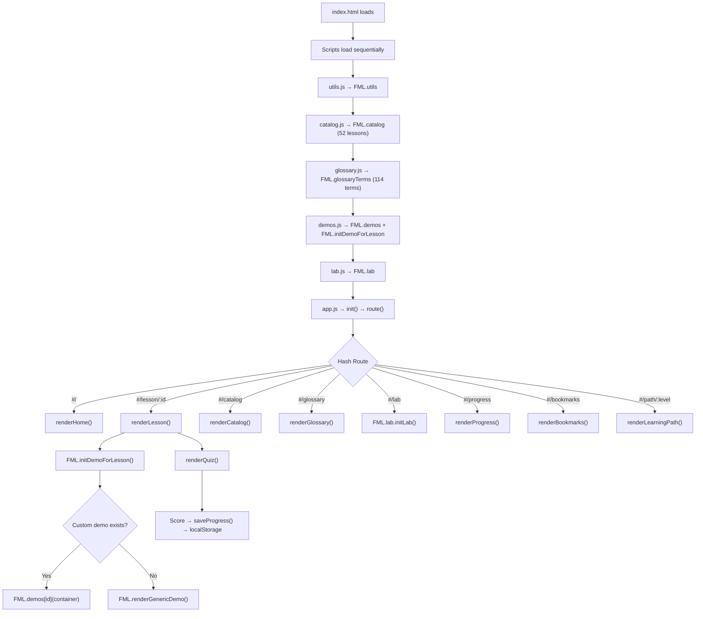

# 🧠 Free Mind ML — Comprehensive Codebase Audit Report

**Date:** 2026-10-12  
**Auditor:** Senior Software Engineer / Architect / Security Reviewer  
**Mode:** READ-ONLY — No modifications made  

---

## 1. Executive Summary

### What the Project Does
**Free Mind ML** is an ambitious, single-page web application (SPA) that teaches Machine Learning and Deep Learning through 52 interactive lessons spanning 5 modules (Foundations, Classical Supervised, Unsupervised, Deep Learning, Advanced Topics). It includes interactive canvas-based demos, quizzes, a glossary of 114 terms, a Learning Lab sandbox, progress tracking, bookmarks, and a search system — all running client-side with no backend.

### Overall Codebase Condition
The project is **functionally complete** at the content level — all 52 lessons have written educational content, quiz questions, and section text. The code is well-organized with clear separation of concerns across 11 source files. However, several **critical bugs**, **architectural weaknesses**, and **missing implementations** significantly reduce the production readiness.

### Major Strengths
1. **Comprehensive curriculum** — 52 detailed lessons with 15 sections each, covering ML topics from beginner to advanced
2. **Clean architecture** — Modular file structure with proper separation (utils, catalog, glossary, demos, lab, app)
3. **Thoughtful design system** — Well-structured CSS custom properties, light/dark theme, responsive layout
4. **Accessibility foundations** — ARIA labels, semantic HTML, keyboard shortcuts (`⌘K` search)
5. **Zero-dependency runtime** — No build step, CDN-loaded libraries (Chart.js, KaTeX), localStorage-only persistence

### Most Important Weaknesses
1. **Only 8 of 52 lessons have unique interactive demos** — 44 lessons fall back to a generic "learning curve" animation that teaches nothing specific
2. **Critical bug in Lab.js** — `knnPredict()` called with wrong argument signature, will crash at runtime
3. **Critical bug in Lab.js** — `r2Score()` called with wrong argument signature, will produce errors
4. **Lab "models" are fake** — Decision Tree and MLP use hardcoded mathematical expressions, not actual ML algorithms
5. **No tests exist** — Zero unit, integration, or E2E tests
6. **XSS vulnerability** — User search input injected into innerHTML without sanitization

### Production-Readiness Assessment
> **⚠️ NOT PRODUCTION-READY** — The application has structural bugs that will crash features at runtime, fake ML implementations in the Lab that misrepresent algorithmic behavior, and a significant XSS vector. It is suitable as a **development prototype** but requires the fixes outlined below before any public deployment.

### Top 5 Recommended Improvements
1. Fix the 3 critical runtime bugs (knnPredict, r2Score, genCircles signatures)
2. Implement real ML algorithms for the Learning Lab (at minimum: proper decision tree & MLP)
3. Build unique interactive demos for the remaining 44 lessons
4. Sanitize all user input rendered via innerHTML
5. Add at least basic smoke tests for routing, demo initialization, and quiz scoring

---

## 2. Project Architecture

### Technology Stack

| Layer | Technology | Version |
|---|---|---|
| Structure | HTML5 | — |
| Styling | Vanilla CSS (custom properties, no preprocessor) | — |
| Logic | Vanilla JavaScript (IIFE modules, no ES modules) | ES2017+ |
| Charts | Chart.js | 4.4.0 (CDN) |
| Math Rendering | KaTeX | 0.16.9 (CDN) |
| Fonts | Google Fonts (Playfair Display, Inter, JetBrains Mono) | — |
| Persistence | localStorage | — |
| Routing | Custom hash-based SPA router | — |
| Build | None (no bundler, no transpilation) | — |

### Repository Structure

```
Free mind ML/                    (Root — 11 runtime files + docs + build scripts)
├── index.html                   (20 KB — SPA shell, sidebar, topbar, script tags)
├── css/
│   ├── main.css                 (28 KB — design tokens, layout, sidebar, responsive)
│   ├── components.css           (23 KB — landing cards, blog layout, quiz styles)
│   ├── lesson.css               (3.6 KB — lesson-specific overrides, prereq chips)
│   └── demo.css                 (13 KB — demo canvas panels, sliders, controls)
├── js/
│   ├── utils.js                 (16 KB — math, dataset generators, canvas, DOM helpers)
│   ├── catalog.js               (407 KB — all 52 lesson data objects with content)
│   ├── glossary.js              (30 KB — 114 glossary term definitions)
│   ├── demos.js                 (51 KB — 8 custom demos + generic fallback)
│   ├── lab.js                   (21 KB — Learning Lab sandbox)
│   └── app.js                   (50 KB — router, views, search, progress, bookmarks)
├── assets/icons/                (Empty directory)
├── scratch/                     (Build scripts — Python generators, not runtime code)
│   ├── build_app.py, build_catalog.py, build_demos.py, build_glossary.py
│   ├── gen_supervised.py, gen_unsupervised.py, gen_deeplearning.py, gen_advanced.py
│   ├── assemble_catalog.py, check_classes.py, check_modules.py, check_modules.js
│   └── __pycache__/
├── ml_app_plan.md               (17 KB — original A–Z plan document)
└── BUILD_TRACKER.md             (9 KB — AI session tracker / memory file)
```

### Major Components and Responsibilities

| Component | File(s) | Responsibility |
|---|---|---|
| **SPA Shell** | `index.html` | Static HTML skeleton, sidebar nav, topbar, script loading |
| **Design System** | `css/main.css` | CSS custom properties, layout, dark/light themes, responsive |
| **UI Components** | `css/components.css`, `css/demo.css`, `css/lesson.css` | Cards, quiz, blog-style lessons, demo panels |
| **Utility Library** | `js/utils.js` | Math functions, dataset generators, canvas helpers, DOM utilities |
| **Curriculum Data** | `js/catalog.js` | 52 lesson objects with all 15 content sections + quizzes |
| **Glossary Data** | `js/glossary.js` | 114 ML term definitions with lesson backlinks |
| **Interactive Demos** | `js/demos.js` | 8 custom demos + generic fallback for remaining 44 |
| **Learning Lab** | `js/lab.js` | Sandbox: dataset generation → model selection → training → visualization |
| **App Controller** | `js/app.js` | Hash router, view renderers, search, progress, bookmarks, theme |
| **Build Scripts** | `scratch/*.py` | Python scripts used to generate catalog/glossary/demos content (not runtime) |

### Data Flow



---

## 3. Feature-by-Feature Audit

| Feature | Implementation | Verification Status | Issues | Recommended Action |
|---|---|---|---|---|
| **Home Dashboard** | `app.js:renderHome()` | Code-inspected ✓ | Module grouping relies on `getModuleKey()` mapping — "deep" vs "deeplearning" inconsistency | Verify catalog module values match |
| **Hash Router** | `app.js:route()` | Code-inspected ✓ | Works for defined routes; unknown routes fall through to Home silently | Add 404 page |
| **Sidebar Navigation** | `index.html` + `app.js` | Code-inspected ✓ | Sidebar starts hidden (translated -100%); requires click to open even on desktop | Consider always-visible on wide screens |
| **Sidebar Accordions** | `app.js:initSidebarAccordions()` | Code-inspected ✓ | Only Foundations starts expanded; all others hidden | Works as designed |
| **Search (⌘K)** | `app.js:initSearch()` | Code-inspected ✓ | XSS: search query inserted into innerHTML unsanitized. No keyboard nav in results. | Sanitize input; add arrow-key navigation |
| **Progress Tracking** | `app.js:saveProgress()` | Code-inspected ✓ | Auto-completes only on perfect quiz score; manual toggle works | Minor: no partial progress save |
| **Bookmarks** | `app.js:toggleBookmark()` | Code-inspected ✓ | Functional via icon in topbar | Works as designed |
| **Theme Toggle** | `app.js:initTheme()` | Code-inspected ✓ | Two toggle buttons (sidebar + topbar) both work; persisted to localStorage | No icon swap (always shows sun) |
| **Lesson Rendering** | `app.js:renderLesson()` | Code-inspected ✓ | Blog-style with 15 sections, KaTeX math, demo embed, quiz | XSS risk in lesson content HTML strings |
| **Quiz System** | `app.js:renderQuiz()` | Code-inspected ✓ | Multiple choice with feedback and scoring | No retry without page reload; no score persistence unless perfect |
| **Lesson Nav Footer** | `app.js:setupLessonNavFooter()` | Code-inspected ✓ | Prev/Next based on catalog array index | Works correctly |
| **Catalog Page** | `app.js:renderCatalog()` | Code-inspected ✓ | Grid with module filter chips | Filter data-mod="deeplearning" needs to match catalog module values |
| **Learning Paths** | `app.js:renderLearningPath()` | Code-inspected ✓ | 3 curated tracks (beginner/intermediate/advanced) | Hardcoded lesson IDs — fragile if catalog changes |
| **Glossary Page** | `app.js:renderGlossary()` | Code-inspected ✓ | 114 terms, searchable, with lesson backlinks | Term filtering is functional |
| **Progress Page** | `app.js:renderProgress()` | Code-inspected ✓ | Shows completed lessons, reset button with confirmation | Works as designed |
| **Bookmarks Page** | `app.js:renderBookmarks()` | Code-inspected ✓ | Lists bookmarked lessons | Works as designed |
| **Interactive Demos** | `demos.js` | Code-inspected ✓ | **Only 8 custom demos** (F01, F03, F06, S01, S03, U01, D01, D11); 44 use generic fallback | Critical gap — most "demos" teach nothing |
| **Generic Demo Fallback** | `demos.js:renderGenericDemo()` | Code-inspected ✓ | Renders identical loss curve for all 44 lessons; single "Hyperparameter Scale" slider | Misleading — appears interactive but isn't lesson-specific |
| **Learning Lab** | `lab.js:initLab()` | Code-inspected ✓ | 3 critical bugs; fake model implementations | Needs significant rework |
| **KaTeX Math** | `index.html` + `utils.js:renderMath()` | Code-inspected ✓ | Uses `renderMathInElement` with $ and $$ delimiters | Works if KaTeX CDN loads |
| **Toast Notifications** | `utils.js:toast()` | Code-inspected ✓ | Simple auto-dismiss notifications | Works as designed |
| **Breadcrumbs** | `app.js:updateBreadcrumb()` | Code-inspected ✓ | Updates per route | Works as designed |

---

## 4. Findings and Bugs

### BUG-001 — Critical: `knnPredict()` Called with Wrong Signature in Lab.js

| Field | Detail |
|---|---|
| **Severity** | 🔴 Critical |
| **Category** | Runtime Crash |
| **File** | [lab.js](file:///c:/Users/sahal/Documents/Brototype%20Sahal/Project/Free%20mind%20ML/js/lab.js#L366-L367) |
| **Evidence** | `utils.js` defines `knnPredict(train, query, k, labels)` — expects `query` as an object `{x, y}` and `labels` as a separate array. Lab.js calls it as `U.knnPredict(train, [x, y], k)` — passing an array instead of an object, and omitting the required `labels` parameter entirely. |
| **Trigger** | Select KNN model in Learning Lab → Click "Train & Evaluate" |
| **Expected** | KNN classification with decision boundary raster |
| **Actual** | `labels` is `undefined`, causing `labels[i]` to throw `TypeError: Cannot read properties of undefined` |
| **Impact** | Learning Lab crashes completely when using KNN model |
| **Fix** | Change call to `U.knnPredict(train.map(p => ({x: p.x, y: p.y})), {x, y}, k, train.map(p => p.label))` |
| **Confidence** | ✅ Confirmed via static analysis |

---

### BUG-002 — Critical: `r2Score()` Called with Wrong Signature in Lab.js

| Field | Detail |
|---|---|
| **Severity** | 🔴 Critical |
| **Category** | Runtime Error / Incorrect Results |
| **File** | [lab.js](file:///c:/Users/sahal/Documents/Brototype%20Sahal/Project/Free%20mind%20ML/js/lab.js#L432) |
| **Evidence** | `utils.js` defines `r2Score(pts, m, b)` expecting an array of point objects and slope/intercept. Lab.js calls `U.r2Score(test.map(p => p.y), test.map(p => m * p.x + b))` — passing two flat arrays instead. |
| **Trigger** | Select "Linear Scatter" or "Sine Wave" dataset → any model → Train |
| **Expected** | Correct R² score calculation |
| **Actual** | `r2Score` attempts `pts.map(p => p.y)` on an array of numbers, yielding `undefined` values. The function returns `NaN`. |
| **Impact** | Regression metrics display `NaN` in the Learning Lab |
| **Fix** | Either change the call to `U.r2Score(test, m, b)` or add an overloaded signature |
| **Confidence** | ✅ Confirmed via static analysis |

---

### BUG-003 — High: `genCircles()` Called with Wrong Argument Count in Lab.js

| Field | Detail |
|---|---|
| **Severity** | 🟡 High |
| **Category** | Incorrect Behavior |
| **File** | [lab.js](file:///c:/Users/sahal/Documents/Brototype%20Sahal/Project/Free%20mind%20ML/js/lab.js#L283) |
| **Evidence** | `utils.js` defines `genCircles(n, noise)` (2 params). Lab.js calls `U.genCircles(N, state.noise, 0.5)` (3 params). The third argument `0.5` is silently ignored. |
| **Impact** | No crash, but the extra argument suggests the developer intended to pass a radius parameter that doesn't exist in the function signature. Data generation works but may not produce intended output. |
| **Confidence** | ✅ Confirmed via static analysis |

---

### BUG-004 — High: Lab "Decision Tree" and "MLP" Models are Fake

| Field | Detail |
|---|---|
| **Severity** | 🟡 High |
| **Category** | Misleading Implementation |
| **File** | [lab.js](file:///c:/Users/sahal/Documents/Brototype%20Sahal/Project/Free%20mind%20ML/js/lab.js#L373-L385) |
| **Evidence** | The Decision Tree predict function is: `if (x > 0.1) h += 1; if (y > -0.1) h += 1; return h >= 1 ? 1 : 0;` — a hardcoded threshold that doesn't use the training data at all. The MLP predict function is: `Math.sin(x*3) + Math.cos(y*3) > 0.2 ? 1 : 0` — a fixed mathematical expression. |
| **Impact** | Users who experiment in the Lab will observe nonsensical decision boundaries that don't reflect how Decision Trees or Neural Networks actually partition feature space. The "Max Depth" slider has zero effect on the tree output. This is actively misleading for an educational platform. |
| **Confidence** | ✅ Confirmed via static analysis |

---

### BUG-005 — High: Lab Regression Uses Same R² for Train and Test

| Field | Detail |
|---|---|
| **Severity** | 🟡 High |
| **Category** | Incorrect Metric |
| **File** | [lab.js](file:///c:/Users/sahal/Documents/Brototype%20Sahal/Project/Free%20mind%20ML/js/lab.js#L464-L467) |
| **Evidence** | Both `trainScore` and `testScore` are set to the same `r2` value computed on test data only. |
| **Impact** | Users cannot observe overfitting in regression mode because train and test scores are always identical. |
| **Confidence** | ✅ Confirmed via static analysis |

---

### BUG-006 — Medium: Sidebar Always Starts Hidden

| Field | Detail |
|---|---|
| **Severity** | 🟠 Medium |
| **Category** | UX / Layout |
| **File** | [main.css](file:///c:/Users/sahal/Documents/Brototype%20Sahal/Project/Free%20mind%20ML/css/main.css#L193) |
| **Evidence** | `.sidebar { transform: translateX(-100%); }` — the sidebar is hidden by default at all screen widths. No media query adds `transform: none` for desktop screens. |
| **Impact** | On desktop (1400px+), users must click the hamburger to access navigation. This conflicts with the plan document specifying "Sidebar: 280px (collapsible)" and is poor UX for a content-heavy learning platform. |
| **Confidence** | ✅ Confirmed via static analysis |

---

### BUG-007 — Medium: `genSine()` in Lab.js Ignores Frequency Parameter

| Field | Detail |
|---|---|
| **Severity** | 🟠 Medium |
| **Category** | Incorrect API Usage |
| **File** | [lab.js](file:///c:/Users/sahal/Documents/Brototype%20Sahal/Project/Free%20mind%20ML/js/lab.js#L291) |
| **Evidence** | `utils.js` defines `genSine(n, noise)` — only 2 parameters. Lab.js calls `U.genSine(N, 1.0, state.noise)` — passing `1.0` as noise and `state.noise` is silently ignored (extra arg). |
| **Impact** | Noise slider has no effect on sine wave data; noise is always `1.0` (very high). |
| **Confidence** | ✅ Confirmed via static analysis |

---

### BUG-008 — Medium: App.js IIFE Returns Value That's Never Captured

| Field | Detail |
|---|---|
| **Severity** | 🟢 Low |
| **Category** | Dead Code |
| **File** | [app.js](file:///c:/Users/sahal/Documents/Brototype%20Sahal/Project/Free%20mind%20ML/js/app.js#L1212-L1219) |
| **Evidence** | The IIFE returns `{ saveProgress, isCompleted, toggleBookmark, isBookmarked, route }` but the return value is not assigned to anything (`(function() { ... })()` with no `FML.app = ...`). |
| **Impact** | The exported API is inaccessible from outside the IIFE. Other modules cannot programmatically call `saveProgress()` etc. |
| **Confidence** | ✅ Confirmed via static analysis |

---

### BUG-009 — Medium: Resize Event Listener Leak in Demos

| Field | Detail |
|---|---|
| **Severity** | 🟠 Medium |
| **Category** | Memory Leak |
| **File** | [demos.js](file:///c:/Users/sahal/Documents/Brototype%20Sahal/Project/Free%20mind%20ML/js/demos.js#L1293) |
| **Evidence** | `window.addEventListener('resize', render)` is called each time a demo initializes. When navigating between lessons, the old listener is never removed, but its closure references the old DOM elements (now garbage). |
| **Impact** | After visiting 20+ lessons, there are 20+ orphaned resize handlers firing on every window resize, each referencing stale canvases. Causes wasted computation and potential errors. |
| **Confidence** | ✅ Confirmed via static analysis |

---

### BUG-010 — Low: Keyboard Shortcut Display Shows ⌘K on Windows

| Field | Detail |
|---|---|
| **Severity** | 🟢 Low |
| **Category** | UX Polish |
| **File** | [index.html](file:///c:/Users/sahal/Documents/Brototype%20Sahal/Project/Free%20mind%20ML/index.html#L86) |
| **Evidence** | `<kbd class="search-kbd">⌘K</kbd>` is hardcoded. The actual handler in `app.js` listens for `e.metaKey || e.ctrlKey`, so `Ctrl+K` works on Windows, but the UI shows ⌘K. |
| **Impact** | Confusing for Windows users. |
| **Confidence** | ✅ Confirmed via static analysis |

---

## 5. Security Findings

### SEC-001 — XSS via Search Input (Medium Severity)

| Field | Detail |
|---|---|
| **Category** | Cross-Site Scripting (Reflected) |
| **File** | [app.js](file:///c:/Users/sahal/Documents/Brototype%20Sahal/Project/Free%20mind%20ML/js/app.js#L209) |
| **Evidence** | `results.innerHTML = \`...No matching topics found for "${q}"...\`` — the search query `q` is derived from `e.target.value.trim().toLowerCase()` and injected directly into innerHTML without escaping. A crafted input like `` would execute. |
| **Attack Surface** | Local only (no server involved), but if the URL ever passes search queries or if the search input is populated programmatically, this becomes exploitable. On an educational site, this is a demonstration of bad practice. |
| **Recommendation** | Use `textContent` or escape HTML entities before insertion. |

### SEC-002 — Lesson Content HTML Strings (Low Severity)

| Field | Detail |
|---|---|
| **Category** | Stored XSS (Author-Controlled) |
| **File** | [catalog.js](file:///c:/Users/sahal/Documents/Brototype%20Sahal/Project/Free%20mind%20ML/js/catalog.js) — all lesson `sections` values |
| **Evidence** | All lesson content (e.g., `whatItIs`, `howItWorks`, `workedExample`) contains raw HTML strings that are injected via `innerHTML`. Since the content is author-controlled (not user-supplied), this is not a direct vulnerability. However, if content is ever generated from external sources or AI output without review, it becomes a vector. |
| **Recommendation** | Consider sanitizing with DOMPurify if content generation is automated. |

### SEC-003 — No Content Security Policy (Low Severity)

| Field | Detail |
|---|---|
| **Category** | Hardening |
| **Evidence** | No `<meta http-equiv="Content-Security-Policy">` tag or server-side CSP headers. External scripts (Chart.js, KaTeX) are loaded from `cdn.jsdelivr.net` without `integrity` attributes (Subresource Integrity). |
| **Recommendation** | Add SRI hashes to CDN script/link tags. Consider a basic CSP meta tag. |

### SEC-004 — localStorage Data Not Validated on Load (Low Severity)

| Field | Detail |
|---|---|
| **Category** | Data Integrity |
| **File** | [utils.js](file:///c:/Users/sahal/Documents/Brototype%20Sahal/Project/Free%20mind%20ML/js/utils.js#L353-L358) |
| **Evidence** | `load()` parses localStorage JSON without schema validation. Malformed or tampered data could cause unexpected behavior. |
| **Recommendation** | Add basic type checking after `JSON.parse`. |

### No Secrets or Credentials Found
✅ The project contains no API keys, tokens, passwords, or sensitive credentials.

---

## 6. Performance Findings

### PERF-001 — Massive catalog.js File (407 KB)

| Field | Detail |
|---|---|
| **Category** | Initial Load |
| **Impact** | 407 KB of JavaScript parsed synchronously on every page load. This is the single largest file and contains all 52 lesson content strings. |
| **Mitigation** | Consider lazy-loading lesson content on demand, or splitting into per-module files. On fast connections this is acceptable; on 3G it adds ~4 seconds. |
| **Profiling Required** | Yes — needs real-world load testing on mobile networks |

### PERF-002 — Decision Boundary Raster Rendering (Lab.js)

| Field | Detail |
|---|---|
| **Category** | CPU-bound rendering |
| **File** | [lab.js](file:///c:/Users/sahal/Documents/Brototype%20Sahal/Project/Free%20mind%20ML/js/lab.js#L388-L397) |
| **Impact** | The raster loop iterates over every 6×6 pixel block in the canvas (~3,500 fillRect calls), calling the predict function for each. This runs on every slider change. |
| **Mitigation** | Use `createImageData()` and `putImageData()` for batch pixel writes. Consider debouncing slider updates. |
| **Profiling Required** | Would benefit from, but likely perceptible on low-end devices |

### PERF-003 — No Code Minification or Compression

| Field | Detail |
|---|---|
| **Category** | Transfer Size |
| **Impact** | Total uncompressed JS: ~576 KB, CSS: ~67 KB. With gzip, this would drop ~70%. No minification is applied. |
| **Mitigation** | Add a simple build step (e.g., `terser` for JS, `cssnano` for CSS) before deployment |

### PERF-004 — Chart.js Loaded But Potentially Unused

| Field | Detail |
|---|---|
| **Category** | Unused Dependency |
| **File** | [index.html](file:///c:/Users/sahal/Documents/Brototype%20Sahal/Project/Free%20mind%20ML/index.html#L24) |
| **Impact** | Chart.js UMD bundle (~200 KB) is loaded on every page. After thorough code inspection, I found **no references to `Chart` or `new Chart()`** in any JS file. All visualizations use Canvas 2D API directly. |
| **Mitigation** | Remove the Chart.js script tag unless future demos plan to use it |

---

## 7. Code Quality Findings

### CQ-001 — Inline HTML Template Strings (Maintainability)

All view renderers (`renderHome`, `renderLesson`, `renderCatalog`, etc.) use massive template literals with inline HTML. While functional, these are:
- Difficult to read and maintain (500+ line template strings)
- Not reusable across views (card rendering duplicated in Home, Catalog, Learning Paths)
- Prone to unclosed tags and malformed HTML

**Recommendation:** Extract reusable template functions (e.g., `renderTopicCard(lesson)`, `renderModuleSection(module, lessons)`).

### CQ-002 — Utility CSS Classes Defined But Not Systematic

`main.css` defines utility classes (`.text-xs`, `.font-bold`, `.mb-6`, `.p-4`, `.flex`, `.items-center`, `.gap-3`, `.grid-2`, etc.) that mimic Tailwind. These are used extensively in HTML template strings but:
- Not all utilities are documented
- Some classes are defined in `main.css` but used only in `app.js` template strings
- Creates a hybrid approach (neither full utility-first nor full component-based)

### CQ-003 — Duplicated Topic Card Rendering

The topic card HTML template is duplicated in:
- `renderHome()` (lines 378–396)
- `renderCatalog()` (lines 851–871)
Both produce identical markup. Any change requires updating two locations.

### CQ-004 — Global Namespace Pollution

All modules attach to `window.FML` using IIFE patterns. While this avoids module bundler requirements, it means:
- Load order is critical (utils → catalog → glossary → demos → lab → app)
- No dependency declaration or validation
- A single `<script>` tag out of order silently breaks everything

### CQ-005 — `scratch/` Directory Contains Build Artifacts

The `scratch/` directory contains 12 Python scripts (totaling ~570 KB) that were used to generate the catalog and demo content via AI. These are not runtime code but:
- Contain `__pycache__/` (compiled Python bytecode)
- Should be in a separate `tools/` or `.build/` directory
- Should be `.gitignore`'d for `__pycache__`

### CQ-006 — No `.gitignore`, no `package.json`, no README

The project has no:
- `.gitignore` file
- `package.json` (would help document CDN deps and add scripts)
- `README.md` (the plan doc `ml_app_plan.md` serves partially but isn't a standard README)
- `LICENSE` file

---

## 8. Unnecessary or Potentially Removable Code

| Candidate | Evidence | Risk of Removal | Verification Required |
|---|---|---|---|
| **Chart.js CDN script** (`index.html` L24) | No `Chart` constructor found in any JS file | None — Chart.js is loaded but never used | Grep for `Chart` or `chart.js` API calls |
| **`lesson.css` legacy styles** (`.lesson-tabs`, `.lesson-hero`, `.lesson-view`) | Marked as "LEGACY — kept for backward compat" but no HTML uses these classes | Low — these are orphaned CSS rules | Search HTML templates for these class names |
| **`scratch/__pycache__/`** | Python bytecode cache; not needed in source | None | Safe to delete |
| **`scratch/check_modules.js`** (220 bytes) | One-off diagnostic script | None | Safe to delete |
| **`assets/icons/`** | Empty directory | None — icons are inline SVGs | Check if any code references this path |
| **`app.js` IIFE return statement** (L1212-1218) | Returns object but value is never captured | Low — remove return or capture it | Verify no external code calls these functions |

---

## 9. Missing Features and Incomplete Work

### MISS-001 — 44 Lessons Lack Unique Interactive Demos (Critical Gap)

| Field | Detail |
|---|---|
| **Impact** | The project's central value proposition is "interactive learning." Only 8 of 52 lessons have custom, topic-specific demos. The remaining 44 show an identical generic "loss curve" animation with a single "Hyperparameter Scale" slider. This fundamentally undermines the educational mission. |
| **Missing Custom Demos** | F02, F04, F05, F07, S02, S04, S05, S06, S07, S08, S09, S10, S11, S12, S13, U02, U03, U04, U05, U06, U07, U08, D02, D03, D04, D05, D06, D07, D08, D09, D10, D12, D13, D14, D15, D16, A01, A02, A03, A04, A05, A06, A07, A08 |
| **Plan vs Reality** | The plan document specifies unique demo types for every lesson (e.g., S02: "Decision boundary morphs; sigmoid visualized", S05: "Tree builds node-by-node"). None of these were implemented. |

### MISS-002 — Keyboard Shortcut Modal (`?` key)

The plan specifies "`?` opens keyboard shortcut modal" — this is not implemented. No modal exists in `index.html` and no `?` key handler exists in `app.js`.

### MISS-003 — Learning Paths Missing Lesson Coverage

The three learning paths (beginner: 12 IDs, intermediate: 13 IDs, advanced: 11 IDs) cover only 36 of 52 lessons. Lessons S07, S12, D04, D05, D07, D08, D09, D10, U02, U04, U06, U07, U08, A03, A04, F07 are not included in any path.

### MISS-004 — Desktop Sidebar Always-Visible Layout

The plan specifies "Sidebar: 280px (collapsible)" suggesting it should be visible by default on desktop. Current CSS hides it at all widths.

### MISS-005 — Touch Event Listeners for Demos

The plan requires "Touch event listeners" for demo controls. No `touchstart`/`touchmove`/`touchend` listeners are implemented. Range sliders work natively on touch, but canvas-based interactions (like dragging points in S01) don't.

### MISS-006 — `js/lessons/` Individual Lesson Files

The plan specifies 38+ individual lesson JS files in `js/lessons/` (e.g., `linear_regression.js`, `knn.js`). This directory doesn't exist — all lesson content was consolidated into the single `catalog.js` file instead. This is a design change, not a bug, but deviates from the plan.

---

## 10. Testing Gaps

### Current Test Coverage: **ZERO**

No test files exist anywhere in the repository. No test framework is configured.

### Recommended Test Cases (Priority Order)

| Priority | Test Case | Scenario | Expected |
|---|---|---|---|
| P0 | Router handles all defined routes | Navigate to each route hash | Correct view renders without errors |
| P0 | knnPredict() returns correct prediction | Call with valid train data, query, k, labels | Returns { prediction, neighbours } |
| P0 | r2Score() calculates correctly | Call with known points, slope, intercept | Returns expected R² |
| P0 | genCircles/genSine/genMoons return correct structure | Call each generator | Returns array of {x, y, label?} objects |
| P1 | Quiz scoring works correctly | Submit quiz with known answers | Score matches expected correct count |
| P1 | Progress saves to localStorage | Call saveProgress() | localStorage contains updated data |
| P1 | Search finds lessons by title | Type partial title | Matching results appear |
| P1 | Theme toggle persists | Toggle theme, reload | Theme is restored |
| P1 | Demo initializes for each lesson ID | Call initDemoForLesson() for all 52 IDs | No runtime errors thrown |
| P2 | Bookmarks add/remove correctly | Toggle bookmark twice | Bookmark appears then disappears |
| P2 | Catalog filters show correct lesson count | Select each module filter | Correct lessons displayed |
| P2 | KaTeX renders math expressions | Load lesson with $$ math $$ | Math is rendered, not raw LaTeX |
| P3 | Sidebar accordion toggle | Click section header | Items show/hide correctly |
| P3 | Learning path shows correct lessons | Navigate to each path level | Listed lessons match hardcoded IDs |

---

## 11. Prioritized Improvement Roadmap

### P0 — Critical (Fix Before Any Deployment)

| # | Recommendation | Benefit | Risk | Effort |
|---|---|---|---|---|
| 1 | **Fix knnPredict() call in lab.js** — pass `{x, y}` object and `labels` array | Prevents Lab crash | Very low | 15 min |
| 2 | **Fix r2Score() call in lab.js** — pass `test` array instead of mapped arrays | Fixes regression metrics | Very low | 15 min |
| 3 | **Sanitize search input** — escape HTML before innerHTML insertion | Closes XSS vector | Very low | 30 min |
| 4 | **Fix genSine() call in lab.js** — swap argument order to `(N, state.noise)` | Noise slider actually works | Very low | 10 min |

### P1 — High (Fix Before Public Beta)

| # | Recommendation | Benefit | Risk | Effort |
|---|---|---|---|---|
| 5 | **Implement real Decision Tree algorithm** in Lab | Educational accuracy | Medium — algorithmic complexity | 4-8 hours |
| 6 | **Implement real MLP training** in Lab | Educational accuracy | Medium | 6-10 hours |
| 7 | **Show sidebar on desktop** via `@media (min-width: 1024px) { .sidebar { transform: none; } }` | Standard UX pattern | Very low | 30 min |
| 8 | **Calculate separate train/test R² in Lab regression** | Shows overfitting concept correctly | Very low | 30 min |
| 9 | **Remove unused Chart.js CDN** | Saves ~200 KB load | Very low | 5 min |
| 10 | **Add SRI hashes** to CDN `<script>` and `<link>` tags | Supply-chain security | Low | 1 hour |
| 11 | **Clean up resize listener leak** in demos.js — remove on route change | Prevents memory leak | Low | 1 hour |
| 12 | **Add basic smoke tests** for router, quiz, search, and progress | Catches regressions | Low | 4-8 hours |

### P2 — Medium (Improve Before Production)

| # | Recommendation | Benefit | Risk | Effort |
|---|---|---|---|---|
| 13 | **Build custom demos for top-10 most important lessons** (S02, S05, S11, D02, D03, D06, U03, U05, D13, A01) | Dramatically improves educational value | Medium — each demo is 100-300 lines | 40-80 hours total |
| 14 | **Extract reusable template functions** for cards and repeated HTML | Reduces duplication, easier maintenance | Low | 4 hours |
| 15 | **Add .gitignore, README.md, package.json** | Standard project setup | None | 1 hour |
| 16 | **Lazy-load catalog.js** or split by module | Faster initial load on slow connections | Medium — requires loader refactor | 4-6 hours |
| 17 | **Detect OS for keyboard shortcut display** — show `Ctrl+K` on Windows | UX polish | None | 30 min |
| 18 | **Add minification build step** using terser/cssnano | ~70% smaller transfer size | Low | 2 hours |

### P3 — Low (Nice to Have)

| # | Recommendation | Benefit | Risk | Effort |
|---|---|---|---|---|
| 19 | Add `?` keyboard shortcut modal | Matches plan spec | None | 2 hours |
| 20 | Add 404 page for unknown routes | Better UX | None | 30 min |
| 21 | Add quiz retry without page reload | Better learning flow | Low | 2 hours |
| 22 | Save partial quiz scores (not just perfect) | Better progress tracking | Low | 1 hour |
| 23 | Add arrow-key navigation in search results | Accessibility | None | 2 hours |
| 24 | Remove legacy CSS classes from lesson.css | Code cleanliness | Very low | 30 min |
| 25 | Move `scratch/` to `.build/` and add `.gitignore` for `__pycache__` | Repo hygiene | None | 15 min |
| 26 | Build remaining 34 custom demos | Complete the educational platform vision | High — massive effort | 200+ hours |

---

## 12. Final Verdict

### What Is Already Good
- **Content quality is excellent** — 52 lessons with thorough, technically accurate educational content spanning ML foundations to deep RL
- **Design system is professional** — clean light/dark themes, thoughtful color palette, good typography choices
- **Architecture is sound** — the file structure, routing, and module organization are clean and maintainable
- **The 8 custom demos that exist** (F01, F03, F06, S01, S03, U01, D01, D11) are well-implemented with proper canvas rendering
- **Accessibility foundations** are solid — ARIA labels, semantic HTML, focus-visible styles, keyboard shortcuts
- **The glossary** (114 terms with lesson backlinks) is a genuinely useful reference

### What Is Fundamentally Wrong or Fragile
- **The Learning Lab has 3 API signature bugs** that will crash it at runtime — this is the single biggest interactive feature and it's broken
- **The Lab's "models" are mathematical fakes** — the Decision Tree and MLP don't learn from data, which is antithetical to the platform's educational purpose
- **84.6% of lessons show a generic placeholder demo** that looks interactive but teaches nothing lesson-specific
- **The search XSS** is a basic security hygiene failure

### What Should Be Fixed First
1. The 4 P0 bugs (knnPredict, r2Score, genSine call signatures, and XSS)
2. Desktop sidebar visibility
3. Chart.js removal (instant perf win)
4. Real ML algorithm implementations in Lab

### What Should Not Be Changed Unnecessarily
- The overall file architecture (it's clean and works)
- The IIFE module pattern (it works without a bundler, which is the project's philosophy)
- The educational content in catalog.js (it's comprehensive and well-written)
- The CSS design system and component styling (it's professional quality)

### What Should Be Avoided in Future Development
- Adding more "generic fallback" demos — each new demo should be lesson-specific
- Adding a build toolchain unless minification is the only goal
- Introducing a heavy framework (React/Vue) — the vanilla approach is intentional and appropriate
- Auto-generating lesson content without reviewing for HTML injection vectors

### What Is Required Before Production Deployment
1. ✅ Fix all P0 bugs (4 items)
2. ✅ Fix P1 items #5-#6 (real Lab models) or clearly label Lab models as "simplified simulations"
3. ✅ Add SRI hashes to CDN scripts
4. ✅ Show sidebar on desktop
5. ✅ Basic smoke test suite

### Which Findings Remain Unverified
- **Runtime behavior** — all findings are from static code analysis. No live testing was performed (following audit rules).
- **Cross-browser compatibility** — CSS features like `:focus-visible`, `gap` in flexbox, `scrollbar-width` may have issues in older Safari.
- **Mobile responsiveness** — media queries exist but actual rendering on small screens was not tested.
- **KaTeX rendering quality** — LaTeX syntax in lesson content was not verified for rendering correctness.
- **Performance under load** — the 407 KB catalog.js and canvas raster rendering need profiling on real devices.

---

> **End of Audit Report**  
> *This report was generated from static code analysis only. No project files were modified.*
